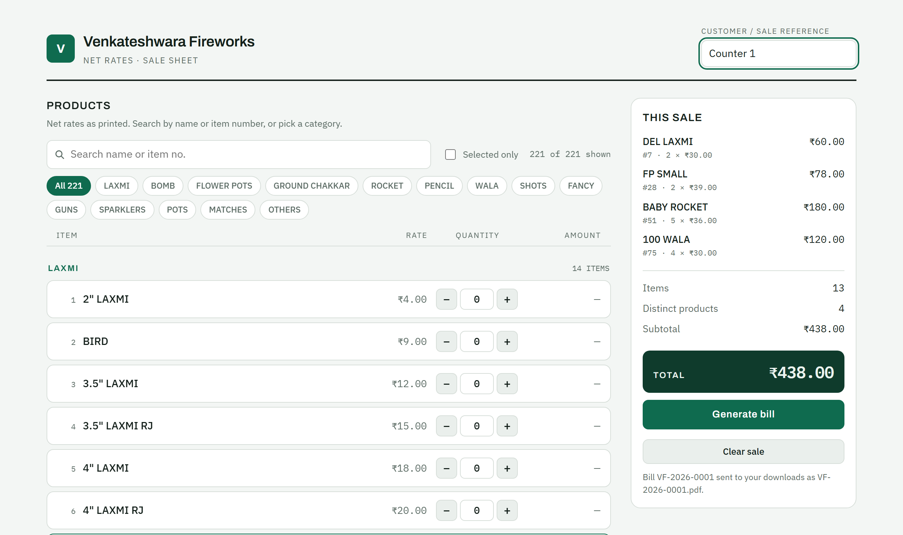

# Venkateshwara Fireworks — Sale Sheet

A counter billing page for a fireworks shop. Open one HTML file, pick quantities
against the printed net-rate list, and generate a numbered PDF bill.

It is a single file with no build step, no server and no dependencies to install.
The PDF engine and the fonts are bundled inside it, so it works with no internet.

**Open it here: https://ruthwick2265.github.io/Venkateshwara-sale-sheet/**



## Use it

Open the link above in any browser, or keep a copy on the machine:

1. Download or clone this repository.
2. Double-click `index.html` (or right-click → Open with → your browser).

Both are the same page, and both work offline once loaded. Nothing to install.

- **Find a product** by name or item number in the search box, or tap a category.
- **Set quantities** with the − / + buttons, or type a number straight into the box.
- **Watch the total** build up in the sale panel (on a phone, in the bar at the bottom).
- **Generate bill** writes a PDF named after the bill number, e.g. `VF-2026-0001.pdf`.

Quantities and the customer reference survive a page reload, so a half-finished
sale is not lost if the browser closes. **Clear sale** empties it.

## On a phone

The page is built for a phone at the counter: the search bar and category strip
stay pinned while the list scrolls, the − / + buttons are thumb-sized, and the
sale summary slides up from the bottom bar, with a **Bill** button beside the total.

Two ways to get it there:

- **Copy the file across** (WhatsApp, a cable, a USB stick), then open it from the
  phone's Files app with Chrome and bookmark it. Works offline afterwards.
  Note that WhatsApp's own preview cannot run a web page — download the file first.
  Google Drive cannot open `.html` as a page either; it will only offer a download.
- **Open the published link** — https://ruthwick2265.github.io/Venkateshwara-sale-sheet/ — in
  the phone's browser. In Chrome, ⋮ → *Add to Home screen* puts it on the home
  screen and it opens like an app. GitHub Pages serves it from `main` / `/ (root)`,
  so every push to `main` updates it within a minute or so.

## Change the rates

Everything you would edit lives at the top of the `<script>` block near the end of
`index.html`, above the line that says no edits are needed below it.

```js
const CONFIG = {
  businessName: "Venkateshwara Fireworks",
  currency: "INR",      // ISO code: "USD", "EUR", "AED"…
  locale: "en-IN",      // number grouping: 1,23,456.00
  taxRate: 0,           // 0 hides the tax line; 0.18 adds 18 per cent to the total
  taxLabel: "GST"
};

const BILL = {
  title: "CASH BILL",
  prefix: "VF",         // bill numbers read VF-2026-0001
  startAt: 1,           // first number to issue — set 251 to carry on from a paper book
  numberingEpoch: "live-2026-11-18",  // change this text to restart numbering at startAt
  addressLines: [],     // e.g. ["Shop 4, Main Road, Medchal", "Ph: 98765 43210"]
  gstin: ""             // printed under the address once filled in
};

const PRODUCTS = [
  { code: 1, name: "2\" LAXMI", price: 4, category: "LAXMI" },
  // … 221 items, in the order they appear on the printed sheet
];
```

A product needs `name` and `price`. `code` is the S.No from the printed sheet and
shows beside the name; `category` groups the list and fills the category strip;
`unit` is optional and prints under the name. Add a row, change a price, delete a
line — the page follows, and nothing else needs touching.

### Bill numbering

Bills count up per device and start over each year. To restart them yourself,
change `numberingEpoch` to any new text; the next bill is `startAt`. To continue
from a paper bill book, set `startAt` to the next number in that book.

The counter lives in the browser on each device, so two phones billing at once
would both issue their own `VF-2026-0001`. Give each device its own `prefix`
(`VF-A`, `VF-B`) if more than one person bills at the same time.

## What's inside the file

| | |
|---|---|
| Page, rate list and logic | ~65 KB |
| [jsPDF](https://github.com/parallax/jsPDF) 2.5.1 + [jspdf-autotable](https://github.com/simonbengtsson/jsPDF-AutoTable) 3.8.2 (MIT) | ~400 KB |
| Archivo and IBM Plex Sans/Mono, Latin subset (SIL Open Font License) | ~126 KB |

They are bundled rather than loaded from a CDN on purpose: a copy of this file
sent to a phone has to work on a counter with no data connection.

The PDF prints amounts as `Rs.` rather than `₹` — the standard PDF fonts have no
rupee glyph. The page itself shows `₹` everywhere.

## A note on the rates and your data

`index.html` contains the full net-rate list, this repository is public, and the
link above publishes it. **Anyone with the link can see those prices.** To take that
back: turn Pages off under Settings → Pages → Branch → **None**, and make the
repository private (Pages then needs a paid plan to publish at all).

Nothing else leaves the device. There is no server, no analytics and no network
call of any kind: quantities, customer references and bills stay in the browser
and in the PDFs you save.

## Browser support

Any current browser — Chrome, Edge, Firefox or Safari, on a desktop or a phone.
Saving a PDF from a local file is the one thing that varies between phone
browsers; if a save is refused, the page opens the PDF in a new tab instead so it
can be saved or shared by hand.
